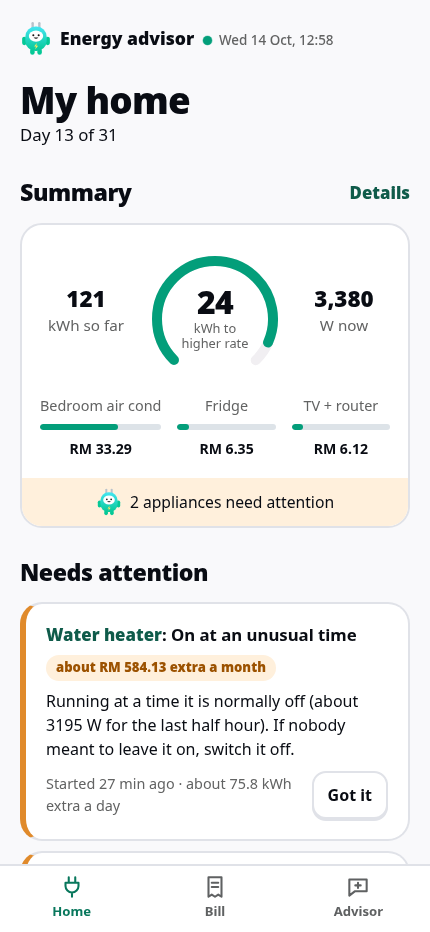
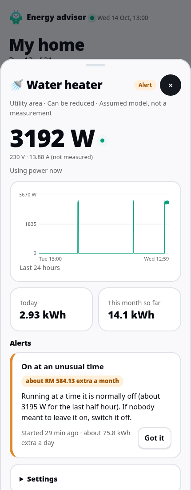
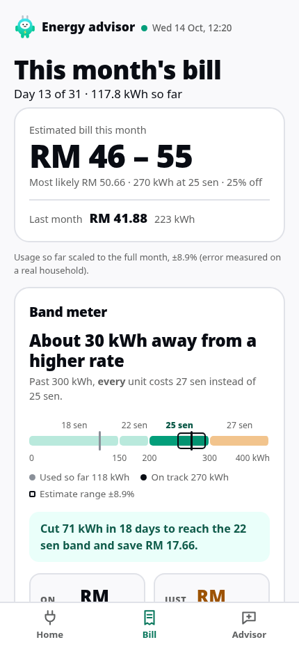
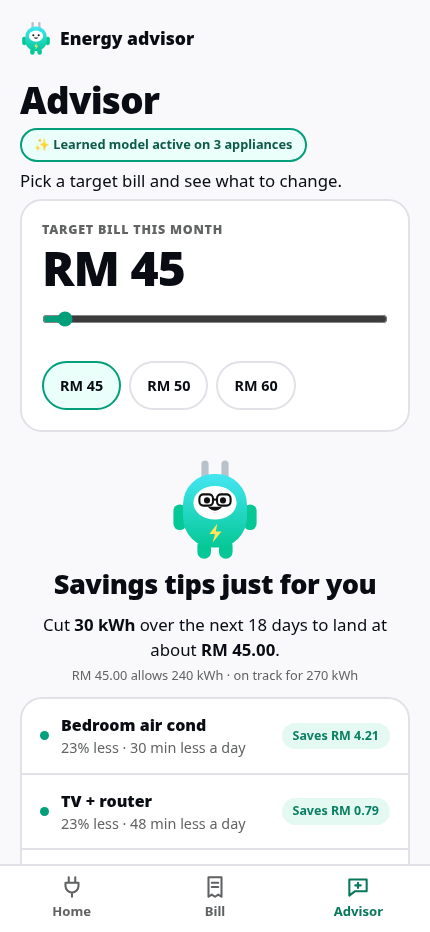
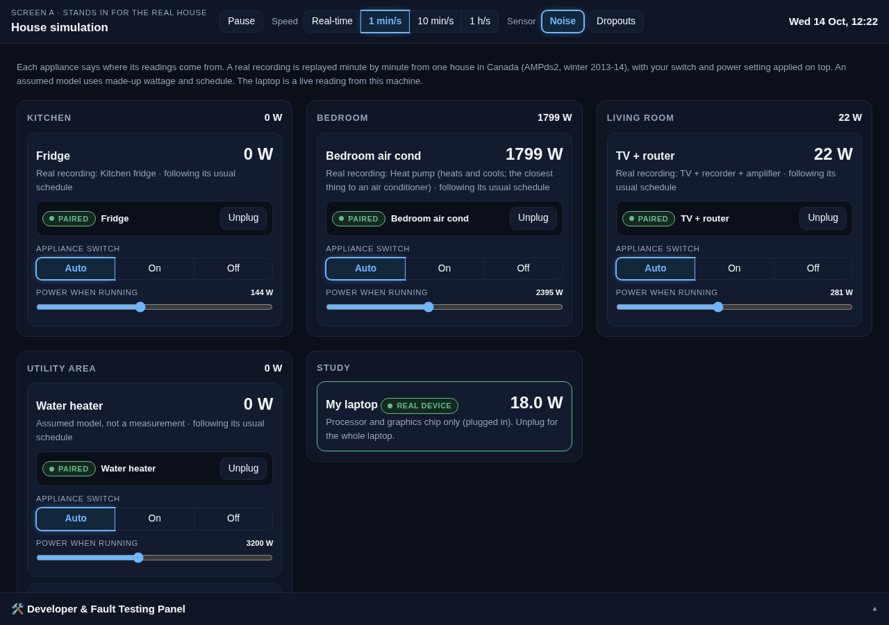

# Energy advisor (prototype)

Built for Dormathon 2026 (AI Hackerdorm), Track 1: Predictive Model.

**Live demo: https://energy-advisor-wvkg.onrender.com** ([app](https://energy-advisor-wvkg.onrender.com/app), [house simulation](https://energy-advisor-wvkg.onrender.com/sim)). It runs on a free server that sleeps after 15 minutes without visitors, so the first visit can take about a minute.

A per-appliance home energy advisor for a Sarawak household. Two programs: **the product** (`server.py`), which knows no appliances, and **a simulated house** (`house.py`) whose plugs replay real appliance recordings and reach the product only over HTTP, as real plugs would. Plus one live device (this laptop).
Python standard library only; nothing to install.

## The problem
Sarawak Energy bills a household at one rate for every unit used in the month, and that rate is set by the band the month's total lands in. One unit over a band line re-prices the whole bill: 300 kWh costs RM 75.00, and 301 kWh costs RM 81.27 (before the 25% discount that runs April to December 2026). Around 714,000 domestic customers are on this tariff.

The bill arrives as one number. It does not say which appliance moved it, or what to change before the month ends.

- **User:** a household on Sarawak Energy's domestic tariff.
- **Decisions it supports:** "Which appliance is costing me extra?" and "I want to pay about RM X, what do I change?"

Sources: the tariff rule is from Sarawak Energy's [discount FAQ](https://www.sarawakenergy.com/media-info/announcements-publications/electric-discount-faq), and the code reproduces its three worked examples to the cent. The discount and customer count are from its [19 April 2026 release](https://www.sarawakenergy.com/media-info/media-releases/2026/sarawak-energy-domestic-customers-to-receive-25-electricity-bill-discount).

## What it looks like
| Home | An alert, explained and priced | Bill | Advisor |
|---|---|---|---|
|  |  |  |  |
| The month so far, the gap to the next rate band, and what needs attention | What was seen, what it costs if it continues, and what to do | The estimate as a range, and how close the month is to a dearer band | Pick a target bill, get a cut per appliance |

The simulated house, which stands in for real smart plugs:



**Try it in a minute.** Open the live demo, or start it yourself (see Run). Then, with the house speed at 1 min/s:
1. In the app, open Advisor and pick RM 45. You get a cut plan per appliance.
2. On the house screen, switch the Water heater to **On**. The app raises "On at an unusual time" in about 25 seconds, with its cost per month.
3. In the Developer & Fault Testing Panel, press **Goes offline** for the TV. "Plug not reporting" appears in about 12 seconds.

## IoT design: how the data gets in
One smart plug per appliance measures its power and reports it over Wi-Fi. The product learns each plug's normal and judges every new reading against it.

```
appliance  -->  smart plug  -->  HTTP + JSON over the network  -->  product (server.py)
                own id, Wi-Fi                                      stores, learns, alerts,
                name, password                                     bills, advises
```

The product knows no appliances until a plug is added. Everything passes through the calls below, and nothing else is shared between the two programs:

| Call | Made by | What it does |
|---|---|---|
| `POST /api/plug/beacon` `{deviceId, ssid, info}` | a plug in pairing mode | Makes the plug visible to the app. When the user asks to add it, the reply carries the password to check. The plug checks it itself and reports `ok` or `wrong_password` |
| `GET /api/discover`, `POST /api/pair` `{deviceId, password, name, type, room}` | the app page | Lists the plugs heard in the last 5 seconds and asks to add one |
| `POST /api/readings` `{readings: [{deviceId, state, voltage_V, current_A, power_W, timestamp}], backlog}` | a paired plug | One reading per minute. `backlog: true` marks stored history, which is saved but not judged as live. The reply carries any on or off command waiting for that plug |

What the product does with a plug's readings:
- Ignores a plug it has not paired, and discards a reading outside 0 to 20,000 W.
- Waits for 14 days of history before judging a new plug. The app shows "Learning: day N of 14".
- Raises "Plug not reporting" when a plug goes quiet for 5 minutes. Missing readings count as missing, not as zero.

**What is real and what is not, in this prototype:**
- **Simulated:** the plugs. `house.py` plays their part and replays real appliance recordings through the calls above (the water heater is an assumed model, since no recording of one exists). Voltage is a nominal 230 V and current is worked out from the watts.
- **Real:** this laptop, read from its own power sensor.
- **Not built:** plug firmware. A real power-monitoring plug would join by making the same two calls a simulated one makes: the beacon and the readings. The calls carry no authentication beyond the pairing password.
- **Open question:** who pays for the plugs.

## Detect, categorise, prioritise, explain
| Step | How the product does it |
|---|---|
| **Detect** | Each plug's readings are compared with that appliance's own learned normal: running watts, usual hours, share of time running. Named statistical checks run first, then a small neural network for patterns the checks did not anticipate |
| **Categorise** | Every alert names its kind: plug not reporting, on at an unusual time, drawing more power than usual, drawing far more power than normal, running more of the time than usual, or an unusual pattern from the learned model |
| **Prioritise** | A finding must persist before it becomes an alert. One alert per appliance and problem: it updates instead of repeating, and clears itself. Each is costed in RM a month through the tariff bands. Overloads rank first, then the rest by cost |
| **Explain** | Each alert says what was seen and what to do, in plain words. From the screenshot above: "Running at a time it is normally off (about 3195 W for the last half hour). If nobody meant to leave it on, switch it off." |

## Results (the "How we know" panel has the full tables)
- **Real data:** month-estimate error on a real household (UCI household power data, one home in France): 12.5% at day 7, 8.3% at day 15, 4.8% at day 20. No model beat this arithmetic.
- **Real rule:** the tariff code reproduces Sarawak Energy's three published examples to the cent. A band's rate applies to every unit.
- **Simulation, 64 randomized hidden changes + 24 normal days:** fixed watt limit 23/64; simple statistics 54/64; small neural network 62/64; both together (what the app runs) 62/64 at a median 3.3 h, about one false alert per 12 normal days.
- **Real recordings, injected faults (`real_proof.json`):** AMPds2, four appliances, settings tuned on year 1 and reported on year 2. Of 120 injected faults: fixed watt limit 7; simple statistics 57; small neural network 40; both together 66 at a median 4.1 h, with about 0.054 false alerts per appliance per day (one per appliance every 18 days). 4 of the 66 are doubtful: the untouched recording alarmed in the same two days. Weakest: running weak 2/16.
- **Noise and missing readings:** the simulation comparison runs with sensor noise on. A test replays normal days with noise and 5% of readings dropped, and expects no alerts.

## Limits
- We wrote both the simulated changes and the detectors: the comparison is not real-world accuracy.
- No real smart plug. The laptop reading is processor + graphics chip power when plugged in (lower than wall draw), whole laptop from the battery when unplugged (that path is tested with fake sensor files only).
- The water heater's wattage and schedule and the advisor's cut limits are assumptions. The replayed house is Canadian, not a Sarawak home, and its faults are injected by us.
- The language model (DeepSeek) only rephrases an answer the calculation already produced; it was checked against the live service on 2026-10-11. Nothing checks that its wording keeps every figure unchanged.
- Storage is in memory: restarting the server regenerates the same simulated history.

## Two screens
**Simulation.** Rooms, each holding its appliances: live watts, the smart plug's state (no plug, ready to pair with its Wi-Fi name and password, connecting, paired), a switch (Auto / On / Off) and a power slider. Fault buttons and the log of what you changed sit in the Developer & Fault Testing Panel at the bottom; the app only ever receives each plug's readings.

**App**, one topic per page:
| Page | What it does |
|---|---|
| Home | Paired plugs by room, live watts, today's usage, online/offline, alerts that need attention. Add a plug: pick its Wi-Fi, enter its password, give it a name, type and room. A new plug shows "Learning: day N of 14" before it is judged. |
| Appliance (a sheet over Home) | Live chart, today and month so far, its alerts with explanation and cost, rename, set its room and class. The app does not switch appliances on or off. |
| Bill | Month estimate as a range, split by appliance, compared with last month, and the band watch. |
| Advisor | "I want to pay RM X": what to cut and what must stay on, plus a chat. |
| How we know (a panel, opened from the app's footer) | What is real, simulated or assumed, with the numbers. |

## How it works
| Part | File | What it really is |
|---|---|---|
| Virtual plugs, faults, manual control | `sim.py` | Fridge, air cond, TV and washer replay real recordings (`traces.json`: AMPds2, one house in Canada, winter 2013-14; the air cond is its heat pump). Water heater: assumed model |
| The house as a program: plug pairing states, HTTP client, simulation screen | `house.py` | Posts JSON readings (`deviceId, state, voltage_V, current_A, power_W, timestamp`) to the product; current is derived from watts at a nominal 230 V |
| Server, storage, pairing, laptop reader, DeepSeek call | `server.py` | http.server + SQLite (in memory) |
| Tariff, bill, named checks, alerts, advisor, scripted chat | `core.py` | Arithmetic, statistics and rules |
| Learned detector | `learned.py` | A small neural network (25-5-25 autoencoder) per appliance, hand-written |
| Replay and detector comparison | `evaluate.py` | Simulation harness |

Detect: named statistical checks first (fast, they say what kind), then the neural network as a second layer for patterns the checks did not anticipate. One alert per problem: it updates, clears itself, and can be acknowledged.

## Run
```bash
python3 server.py                 # product + simulated house (house.py on the next port), then open the two screens below
python3 server.py --no-house      # product alone      |  python3 house.py   house alone (--app URL --port N)
python3 server.py --port 8799     # another port      |  --lan  to reach it from a phone on the same Wi-Fi
python3 -m unittest               # 37 tests, about 30 s
python3 evaluate.py               # reruns the detector comparison (about 7 min), writes proof.json
python3 real.py                   # same detectors on the real recordings (about 10 min), writes real_proof.json; needs the AMPds2 files, see Data
DEEPSEEK_API_KEY=... python3 server.py   # chat is rephrased by DeepSeek (also read from a .env above this folder); without it the chat is scripted
```
- Start page (what it is, live figures, how to try it): http://127.0.0.1:8765/
- App (what the user sees): http://127.0.0.1:8765/app
- Simulation (stands in for the house): http://127.0.0.1:8765/sim, passed through from the house program on http://127.0.0.1:8766/

## Deploy (Render, free plan)
`render.yaml` describes one web service. In Render: New > Blueprint, pick this repo, then type `DEEPSEEK_API_KEY` when asked (leave it empty for a scripted chat).
- A host sets `PORT`; the server then binds every interface and serves all three pages on that one port.
- Anyone with the link can use every control, including the fault buttons. Language-model calls are capped at `LLM_DAILY_CAP` a day (default 300), then the chat answers from the script.
- The free plan stops the service after 15 minutes without visitors. The next visit waits about a minute, and the house then replays its history from the start. Nothing is stored between runs.
- "This laptop" shows no reading on a host: a server has no laptop power sensor.

## Start page on Vercel (optional)
`site/` is the start page as a static site, so it loads at once even while the Render service is asleep. In Vercel: Add New > Project, pick this repo, set Root Directory to `site`, framework preset Other, Deploy.
- `site/vercel.json` passes the page's three read-only figure calls on to the Render service and redirects `/app` and `/sim` there. It points at this project's Render service, `https://energy-advisor-wvkg.onrender.com`: for your own copy, change all five lines to your service's address.
- Vercel cannot run the app itself: it runs short stateless functions, and the app is one long-running process that keeps its readings in memory.

## Data
- `traces.json` is a 19-week cut of **AMPds2**, licensed CC BY 4.0: Makonin, S., Ellert, B., Bajić, I. V. & Popowich, F. "Electricity, water, and natural gas consumption of a residential house in Canada from 2012 to 2014." *Scientific Data* 3, 160037 (2016). https://doi.org/10.1038/sdata.2016.37. Changes: only the power column of four meters (fridge, heat pump, TV, washer), cut to 19 weeks from 2013-11-12 and rounded to whole watts.
- `python3 real.py` and `python3 real.py traces` need the original files (`Electricity_FGE.csv`, `HPE`, `TVE`, `CWE`), which are too large for this repo. Download them from https://doi.org/10.7910/DVN/FIE0S4 into `data/ampds2/`, two folders above this one. The app and the tests do not need them.
